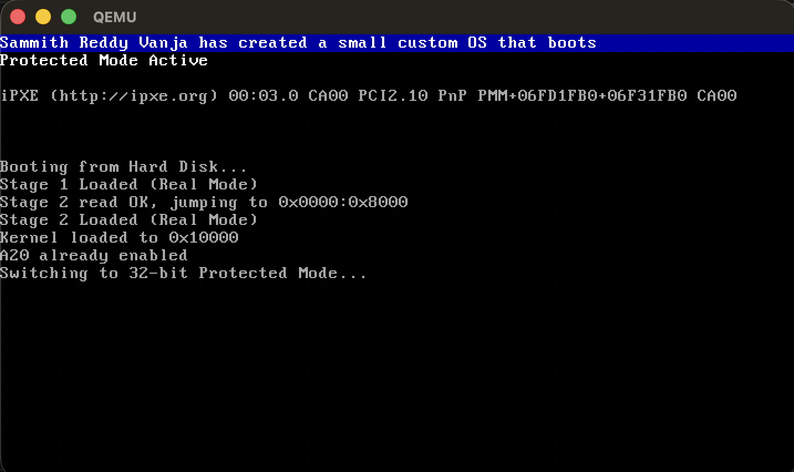
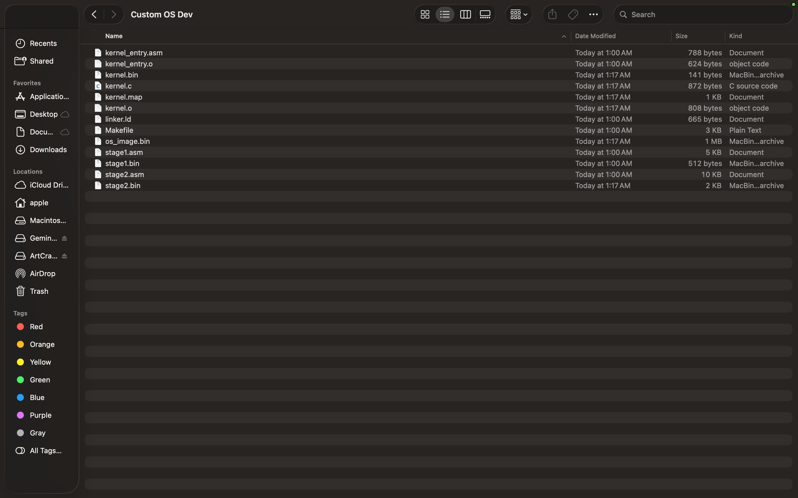

# Custom x86 OS — Multi-Stage BIOS Bootloader + C Kernel

A small operating system written from scratch for x86. A hand-written two-stage BIOS bootloader takes the CPU from 16-bit real mode into 32-bit protected mode and hands off to a freestanding C kernel. It is built and run on an Apple Silicon (M-series) Mac using a cross-compiler and QEMU.



## What happens at boot

1. **BIOS** loads the first disk sector (`stage1.asm`) to `0x7C00` and jumps to it.
2. **Stage 1 (MBR, 512 bytes)** sets up segments and a stack, prints `Stage 1 Loaded (Real Mode)`, reads Stage 2 from disk with `int 0x13` (3 retries with disk reset), and far-jumps to `0x0000:0x8000`.
3. **Stage 2** loads the kernel to `0x10000`, enables the A20 line (BIOS `int 0x15`, Fast A20 port `0x92`, or the 8042 keyboard controller, verified after each attempt), loads a flat GDT, sets `CR0.PE`, and far-jumps into 32-bit code.
4. **32-bit protected mode**: segment registers are reloaded with the data selector `0x10`, the stack is set to `0x90000`, and `Protected Mode Active` is written directly to VGA memory at `0xB8000`.
5. **C kernel**: `kernel_entry.asm` clears `.bss` and calls `main()` in `kernel.c`, which writes the banner straight to VGA text memory (white on blue) with no standard library.

## Project structure

| File | Purpose |
|---|---|
| `stage1.asm` | 512-byte MBR boot sector (16-bit real mode), ends with the `0xAA55` signature |
| `stage2.asm` | Second stage: kernel loading, A20, GDT, switch to protected mode (exactly 2048 bytes) |
| `kernel_entry.asm` | 32-bit bridge that zeroes `.bss` and calls the C `main` |
| `kernel.c` | Freestanding C kernel writing to the VGA text buffer |
| `linker.ld` | Links the kernel as a flat binary at `0x10000`, entry code first |
| `Makefile` | Builds, verifies and boots the disk image |

## Memory and disk layout

| Disk sectors (LBA) | Contents | Loaded to | Loaded by |
|---|---|---|---|
| 0 | `stage1.bin` | `0x7C00` | BIOS |
| 1–4 | `stage2.bin` | `0x8000` | Stage 1 |
| 5 onward | `kernel.bin` | `0x10000` | Stage 2 |

GDT: null descriptor, a ring-0 code segment (selector `0x08`, access `0x9A`, flags `0xC`) and a ring-0 data segment (selector `0x10`, access `0x92`, flags `0xC`), both covering the full 4 GiB.

## Requirements (macOS, Apple Silicon)

```bash
brew install nasm qemu x86_64-elf-gcc x86_64-elf-binutils
```

If `x86_64-elf-gcc` is not installed, the Makefile falls back to Apple `clang -target i386-pc-none-elf` with `ld.lld` (`brew install lld`).

## Build and run

```bash
make run
```

This assembles both stages, compiles and links the kernel, combines everything into `os_image.bin`, checks the image (512-byte Stage 1, `0x55AA` signature, 2048-byte Stage 2), and boots it with:

```bash
qemu-system-x86_64 -drive format=raw,file=os_image.bin,index=0,media=disk
```

Other targets:

| Command | What it does |
|---|---|
| `make` | Build and verify `os_image.bin` without booting |
| `make debug` | Boot paused with a GDB stub on port 1234 |
| `make clean` | Remove all build outputs |

## Project files



## Author

Sammith Reddy Vanja
